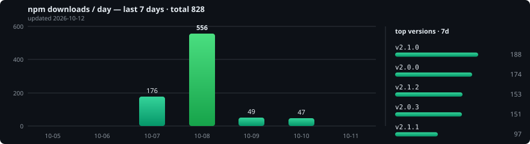

# LogXpert

[](https://www.npmjs.com/package/logxpert)
[](https://www.npmjs.com/package/logxpert)
[](https://github.com/lighscent/LogXpert/actions)
[](LICENSE)
[](NODE_SUPPORT.md)

Colorful console logging for Node.js with optional daily file rotation.

- Zero heavy dependencies — built-in engine.
- Daily file rotation with retention, size limits and gzip.
- Per-level colors, lazy messages, child loggers, isolated instances.
- Works from JS and TS, CommonJS and ESM.

## Installation

```sh
npm install logxpert
```

Requires Node.js `>=18`. Recommended minimum: Node.js 22 LTS. See [NODE_SUPPORT.md](NODE_SUPPORT.md) for the full support policy.

## Quick start

```js
const log = require('logxpert');
// or: import log from 'logxpert';

log('general message');          // shortcut for info
log.info('hello', { user: 1 });  // with metadata
log.error(new Error('boom'));    // Errors print message + stack
log.debug(() => JSON.stringify(hugeObject)); // lazy: skipped if level disabled
```

Levels: `error → warn → info → http → verbose → debug → silly` (default `debug`).

```js
log.setLevel('info'); // or via LOG_LEVEL env variable
```

## File logging

```js
log.settings({ files: { folder: 'logs' } });
// → logs/logxpert-2026_10_08.log (prefix defaults to your package.json name)

log.settings({ files: { folder: 'logs', prefix: 'api' } });
// → logs/api-2026_10_08.log

// Full control (omit prefix when used):
log.settings({ files: { folder: 'logs', filePattern: 'app-%datePattern%.log' } });
```

`%datePattern%` is replaced by the date (`datePattern` defaults to `YYYY_MM_DD`). Combining `prefix` with `filePattern` throws — pick one.

```js
log.settings({
  files: {
    folder: 'logs',
    runNumber: true,    // off by default → app-2026_10_08-1.log, -2.log, ...
    maxFile: '14d',     // retention
    maxSize: '20m',     // rotate above this size
    zippedArchive: true,
  },
});
log.close(); // call on shutdown
```

## Console & instances

```js
log.settings({
  console: {
    enableTimestamp: true,
    timestampFormat: 'YYYY-MM-DD HH:mm:ss',
    colorize: true,
    colors: { info: 'blue', error: false }, // names, ANSI 0-255, or false per level
  },
});

// Default colors: error red, warn yellow, info green, http magenta,
// verbose cyan, debug blue, silly gray. Only the [level] tag is colored.

const { createLogger } = require('logxpert');
const apiLog = createLogger({ level: 'info' }); // independent instance

const child = log.child({ service: 'api' }); // bound context
```

## Full configuration (copy-paste)

```js
log.settings({
  level: 'debug', // or process.env.LOG_LEVEL
  sanitize: true, // strip ANSI escapes and control chars; false = pass through untouched
  console: {
    enableTimestamp: true,
    timestampFormat: 'YYYY-MM-DD HH:mm:ss',
    timestampPrefix: '',
    timestampSuffix: '',
    colorize: true,
    colors: { info: 'blue', warn: 208, error: false }
    // enabled: false, // file-only logging: silence the console
  },
  files: {
    folder: 'logs',
    prefix: undefined, // defaults to your package.json name
    // filePattern: 'app-%datePattern%.log', // full control (omit prefix if used)
    datePattern: 'YYYY_MM_DD',
    runNumber: false, // or true, or { separator: '-', padding: 0, startAt: 1 } — per-day, resets to startAt each new day
    maxFile: '14d',
    maxSize: '20m',
    zippedArchive: false,
  }
});
```

Legacy aliases: `appName` (= `prefix`), `filename`/`pattern` (= `filePattern`), `filesName`/`dateFormat` (= `datePattern`).

Security: messages are stripped of ANSI escapes and control characters (except `\n`, `\t`); file patterns escaping the log folder (`..`, absolute paths) are rejected.

Reliability: a failing transport never throws and never loops — the error goes to `onError(err, transport, entry)` passed to `createLogger()`, defaulting to a raw stderr line.

## Download stats

[](https://www.npmjs.com/package/logxpert)

## Benchmarks

<!-- bench-report:start -->
Latest: _published automatically with each release_ — [all version reports](benchmarks/reports/)
<!-- bench-report:end -->

## License

Apache-2.0. See [LICENSE](LICENSE).
