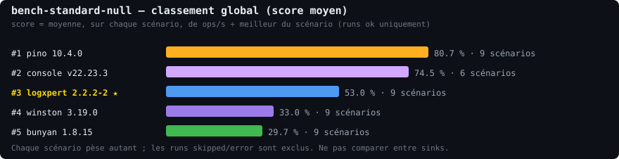
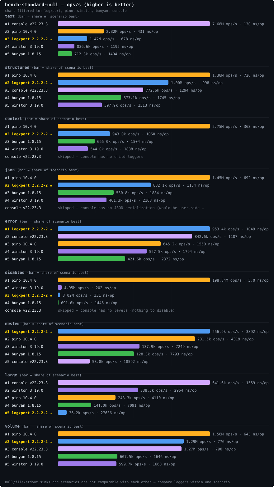

# Benchmark report — bench-standard-null

Run: 2026-10-16 15:37:55.541 UTC · commit `5f9814b`

## Environment

| key | value |
| --- | --- |
| node | v22.23.3 |
| platform/arch | linux / x64 |
| CPU | AMD EPYC 9V45 96-Core Processor x4 |
| suite | standard (reps 5, warmup 2000) |
| sink | null · isolate yes · order round |
| versions | bunyan@1.8.15, console@v22.23.3, logxpert@2.2.2-2, pino@10.4.0, winston@3.19.0 |

## Classement global

| rang | logger | version | score moyen | scénarios |
| ---: | --- | --- | ---: | ---: |
| 1 | pino | 10.4.0 | 80.7 % | 9 |
| 2 | console | v22.23.3 | 74.5 % | 6 |
| 3 | logxpert ★ | 2.2.2-2 | 53.0 % | 9 |
| 4 | winston | 3.19.0 | 33.0 % | 9 |
| 5 | bunyan | 1.8.15 | 29.7 % | 9 |

_Méthode : pour chaque scénario, score = ops/s ÷ meilleur du scénario (runs `ok` uniquement), puis moyenne à poids égal. Les `skipped`/`error` sont exclus._

## Results

### text

| logger | version | status | ops/s | vs logxpert | mean ns/op | iterations | heap Δ |
| --- | --- | --- | ---: | ---: | ---: | ---: | ---: |
| console | v22.23.3 | ok | 7.68M | +420.7 % | 130 | 100000 | 56.0 KB |
| pino | 10.4.0 | ok | 2.32M | +57.3 % | 431 | 100000 | 303.0 KB |
| logxpert | 2.2.2-2 | ok | 1.47M | référence | 678 | 100000 | 401.1 KB |
| winston | 3.19.0 | ok | 836.6k | -43.3 % | 1195 | 100000 | 55.27 MB |
| bunyan | 1.8.15 | ok | 712.3k | -51.7 % | 1404 | 100000 | 120.2 KB |

### structured

| logger | version | status | ops/s | vs logxpert | mean ns/op | iterations | heap Δ |
| --- | --- | --- | ---: | ---: | ---: | ---: | ---: |
| pino | 10.4.0 | ok | 1.38M | +37.5 % | 726 | 100000 | 252.2 KB |
| logxpert | 2.2.2-2 | ok | 1.00M | référence | 998 | 100000 | 109.1 KB |
| console | v22.23.3 | ok | 772.6k | -22.9 % | 1294 | 100000 | -416.4 KB |
| bunyan | 1.8.15 | ok | 573.1k | -42.8 % | 1745 | 100000 | -264.1 KB |
| winston | 3.19.0 | ok | 397.9k | -60.3 % | 2513 | 100000 | 80.92 MB |

### context

| logger | version | status | ops/s | vs logxpert | mean ns/op | iterations | heap Δ |
| --- | --- | --- | ---: | ---: | ---: | ---: | ---: |
| pino | 10.4.0 | ok | 2.75M | +191.8 % | 363 | 100000 | 454.3 KB |
| logxpert | 2.2.2-2 | ok | 943.0k | référence | 1060 | 100000 | 216.9 KB |
| bunyan | 1.8.15 | ok | 665.0k | -29.5 % | 1504 | 100000 | 172.5 KB |
| winston | 3.19.0 | ok | 544.0k | -42.3 % | 1838 | 100000 | 63.83 MB |
| console | v22.23.3 | skipped | n/a | n/a | n/a | n/a | n/a |

### json

| logger | version | status | ops/s | vs logxpert | mean ns/op | iterations | heap Δ |
| --- | --- | --- | ---: | ---: | ---: | ---: | ---: |
| pino | 10.4.0 | ok | 1.45M | +63.9 % | 692 | 100000 | 615.9 KB |
| logxpert | 2.2.2-2 | ok | 882.1k | référence | 1134 | 100000 | 11.7 KB |
| bunyan | 1.8.15 | ok | 530.8k | -39.8 % | 1884 | 100000 | 205.7 KB |
| winston | 3.19.0 | ok | 461.3k | -47.7 % | 2168 | 100000 | 111.52 MB |
| console | v22.23.3 | skipped | n/a | n/a | n/a | n/a | n/a |

### error

| logger | version | status | ops/s | vs logxpert | mean ns/op | iterations | heap Δ |
| --- | --- | --- | ---: | ---: | ---: | ---: | ---: |
| logxpert | 2.2.2-2 | ok | 953.4k | référence | 1049 | 30000 | 468.5 KB |
| console | v22.23.3 | ok | 842.6k | -11.6 % | 1187 | 30000 | 572.5 KB |
| pino | 10.4.0 | ok | 645.2k | -32.3 % | 1550 | 30000 | 1.25 MB |
| winston | 3.19.0 | ok | 557.5k | -41.5 % | 1794 | 30000 | 13.83 MB |
| bunyan | 1.8.15 | ok | 421.6k | -55.8 % | 2372 | 30000 | 563.9 KB |

### disabled

| logger | version | status | ops/s | vs logxpert | mean ns/op | iterations | heap Δ |
| --- | --- | --- | ---: | ---: | ---: | ---: | ---: |
| pino | 10.4.0 | ok | 198.84M | +6482.2 % | 5.0 | 200000 | 36.5 KB |
| winston | 3.19.0 | ok | 4.95M | +63.8 % | 202 | 200000 | 1.44 MB |
| logxpert | 2.2.2-2 | ok | 3.02M | référence | 331 | 200000 | 465.1 KB |
| bunyan | 1.8.15 | ok | 691.6k | -77.1 % | 1446 | 200000 | 976.0 KB |
| console | v22.23.3 | skipped | n/a | n/a | n/a | n/a | n/a |

### nested

| logger | version | status | ops/s | vs logxpert | mean ns/op | iterations | heap Δ |
| --- | --- | --- | ---: | ---: | ---: | ---: | ---: |
| logxpert | 2.2.2-2 | ok | 256.9k | référence | 3892 | 30000 | 631.6 KB |
| pino | 10.4.0 | ok | 231.5k | -9.9 % | 4319 | 30000 | 336.9 KB |
| winston | 3.19.0 | ok | 137.9k | -46.3 % | 7249 | 30000 | 72.97 MB |
| bunyan | 1.8.15 | ok | 128.3k | -50.1 % | 7793 | 30000 | -376.6 KB |
| console | v22.23.3 | ok | 53.8k | -79.1 % | 18592 | 30000 | 1.85 MB |

### large

| logger | version | status | ops/s | vs logxpert | mean ns/op | iterations | heap Δ |
| --- | --- | --- | ---: | ---: | ---: | ---: | ---: |
| console | v22.23.3 | ok | 641.6k | +1673.2 % | 1559 | 30000 | 441.3 KB |
| winston | 3.19.0 | ok | 338.5k | +835.5 % | 2954 | 30000 | 19.83 MB |
| pino | 10.4.0 | ok | 243.3k | +572.4 % | 4110 | 30000 | 25.8 KB |
| bunyan | 1.8.15 | ok | 141.0k | +289.8 % | 7091 | 30000 | 977.2 KB |
| logxpert | 2.2.2-2 | ok | 36.2k | référence | 27636 | 30000 | -5.22 MB |

### volume

| logger | version | status | ops/s | vs logxpert | mean ns/op | iterations | heap Δ |
| --- | --- | --- | ---: | ---: | ---: | ---: | ---: |
| pino | 10.4.0 | ok | 1.56M | +20.7 % | 643 | 100000 | 1.59 MB |
| logxpert | 2.2.2-2 | ok | 1.29M | référence | 776 | 100000 | 487.8 KB |
| console | v22.23.3 | ok | 1.27M | -1.8 % | 790 | 100000 | 13.94 MB |
| bunyan | 1.8.15 | ok | 607.5k | -52.9 % | 1646 | 100000 | 638.4 KB |
| winston | 3.19.0 | ok | 599.7k | -53.5 % | 1668 | 100000 | 65.31 MB |

## Skips

- console :: context :: null — skipped: console has no child loggers
- console :: json :: null — skipped: console has no JSON serialization (would be user-side JSON.stringify)
- console :: disabled :: null — skipped: console has no levels (nothing to disable)

## Notes

- Bars are scaled to the best logger **within each scenario**; bar lengths are not comparable across scenarios.
- Scenario tables show the status only; skip/error reasons are listed under Skips above.
- Numbers are medians over reps; see the sibling `.json` file for per-rep detail.
